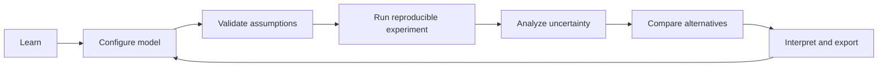
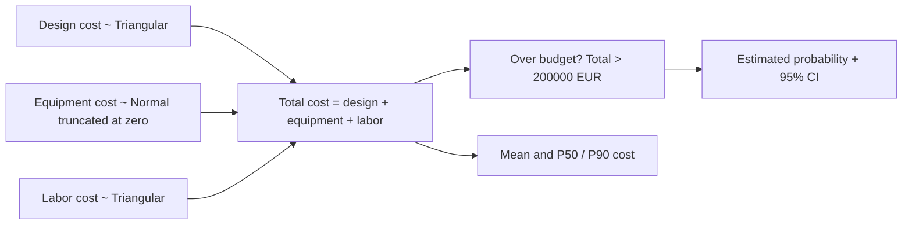

# Monte Carlo Simulation Lab — Comprehensive Upgrade Plan

> **Agent-ready implementation contract · Version 2.0 · 18 November 2026**  
> Read with [`STYLE.md`](./STYLE.md). `PLAN.md` owns product behavior, numerical/statistical correctness, architecture, migration, and delivery; `STYLE.md` owns appearance, visualization, interaction, and accessibility. **This is a target specification, not a claim that the current repository has been inspected or modified.**

## 1. Mission, source authority, and working rules

### 1.1 Product vision

Transform the existing **Monte Carlo Simulation Lab** into a polished, scientifically defensible, highly interactive **simulation and uncertainty analysis learning environment**. Students should move through **Define a question → Build a model → Validate → Simulate → Analyze → Compare → Explain**, without losing access to a fast, approachable standalone simulation. Instructors and researchers should obtain reproducible experiment bundles, transparent assumptions, interpretable uncertainty, and portable Python/R counterparts.

**Design reference:** the supplied `PLAN(9).md` / `STYLE(8).md` follow the successful BPMN Studio-derived approach: compact analytical workspace; clear modules; staged implementation; strict data/algorithm contracts; local-first projects; examples, lessons and challenges; polished light/dark modes. Adapt this approach to stochastic simulation rather than introducing BPMN or Markov-specific functionality.

| Supplied source | Authority | Does **not** establish |
| --- | --- | --- |
| `README(3).md` | Name, seven current simulations, general workflow and the documented React 19 / Vite / vanilla CSS / Recharts / Canvas / KaTeX / Prism / Lucide stack; Python/R snippet exports | Exact repository components, algorithms, saved data, tests, package versions, performance measurements |
| `PLAN(9).md` | Audit-first discipline; Learn/Model/Validate/Simulate/Analyze/Compare cycle; versioned domain snapshots; worker and seeded RNG architecture; tests; phased agent ownership | That its Markov-specific algorithms or milestones apply to Monte Carlo |
| `STYLE(8).md` | BPMN Studio-derived precise palette, typography, dimensions, components, responsiveness, dual themes, chart recipes | That the Monte Carlo repository already uses these tokens or has working accessibility features |

**Status convention:** `MUST` = essential in its assigned release phase; `SHOULD` = preferred and may be changed with recorded rationale; `LATER` = explicitly outside initial release. Every task checkbox is initially unchecked. Only mark done after code and evidence exist. Preserve existing functioning behavior; correct defects with regression tests and migration notes.

### 1.2 What agents must do first

1. Read repository instructions (`AGENTS.md`, `CLAUDE.md`, existing READMEs), `package.json`, lockfile, current source, examples, and deploy configuration. Do not presume paths or installed packages from these documents.
2. Run the existing package manager's install, test (if any), lint (if any), and production build; log baseline failures **before** changing the project.
3. Document architecture, formula implementations, RNG usage, parameter controls, graph performance, and generated code in `docs/current-state-audit.md`. Capture representative screenshots of all seven simulations, in the original themes and on desktop/mobile.
4. Capture default inputs, graph output/appearance, and sample export for each of the seven modules. Preserve originals as fixtures or documented snapshots.
5. Mark discrepancies between the README and code as `documented / verified / missing / broken`. Do not call a README promise an implemented feature.
6. Establish technical decision records (`docs/architecture/ADR-*.md`) for RNG, statistical methods, worker transport, project persistence, graph library, and code-export strategy **before** irreversible refactors.
7. Deliver the first vertical slice: **open Estimating Pi → edit sample size and seed → run/pause/reproduce → see result + valid interval → export reproducible run → reopen → check both themes**.

### 1.3 Product boundaries and guardrails

- **Local-first browser application** is the default. No login, paid service, database server, or AI provider is required to learn, model, or simulate.
- Preserve `npm run dev`, `npm run build` and production-ready **Netlify and Railway** deployments if the audited repository uses npm. Both hosting targets are release requirements; a backend remains optional.
- Monte Carlo simulation **estimates quantities using random sampling**; it does not magically calculate true probabilities or establish a forecasting guarantee. The UI must identify when a quantity is analytical, sampled, assumed, estimated, or unknown.
- Exact reference values (when available) must be clearly distinguished from simulation estimates and user-supplied assumptions.
- No financial investment advice or scientifically unfounded stock-price predictions. GBM is an **illustrative stochastic price model**, not a validated forecast.
- No `eval`, `new Function`, arbitrary user JS execution, unsafe package dynamic imports from uploaded projects, or arbitrary expressions executed in an unrestricted interpreter.
- Prioritize **correctness + preserved workflows** over shiny but scientifically misleading animations.

## 2. Existing feature preservation matrix

Audit every B-item. Do not discard examples or existing Python/R exports while replacing the interface.

| ID | Existing documented feature | Preserve and upgrade | Test / evidence |
| --- | --- | --- | --- |
| B01 | **Estimating Pi** dart-based geometric sampling | Scatter inside/outside; sample-size control; estimator and convergence; analytic π comparison; interval; seed | Fixed-seed replay, quarter-area test, axis geometry, convergence trend |
| B02 | **Monte Carlo Integration** | Definite integral and area visualization; sin on `[0,π]`; mathematically valid signed-integrand estimator | Constant, linear, sine, negative integrand, reversed-bounds behavior |
| B03 | **Monty Hall Problem** | Stay and switch simulations with faithful host behavior | Deterministic game traces and approximate 1/3 vs 2/3 tests |
| B04 | **2D Random Walk** | Interactive 2D trajectories, walkers and step count; displacement teaching | Single-step geometry, E[R²], ensemble statistics |
| B05 | **Stock Price Prediction (GBM)** | Multiple GBM paths, `S0`, drift, volatility, horizon and fan chart | Exact discretization, zero-volatility and analytic moment fixtures |
| B06 | **Project Scheduling & Risk** | Procurement/construction/inspection durations; deadline chance | Duration constraints, total or DAG schedule, on-time estimation |
| B07 | **Manufacturing Quality Control** | Breakdown, shortages, labor availability and production outputs | Physical/unit constraints, deterministic and edge-case fixtures |
| B08 | Adjustable parameters and samples | Keep immediate feedback but avoid heavy recalculation on every keystroke; explicit run/apply controls where needed | Invalid/partial typing, 1 to many replications, cancel |
| B09 | Dynamic Canvas / Recharts visuals | Improve readability and correctness; use worker aggregation and bounded sampled points | 1k/100k/1m sampling performance tiers, stable UI |
| B10 | KaTeX mathematical explanations | Derivation + intuitive story + contextual concept explanations | Accessible formula alternatives and mathematical spot checks |
| B11 | Python and R code snippets | Preserve **both** languages, copy interactions, current-parameter export | Syntax and executable correctness against reference fixtures |
| B12 | Sidebar navigation + theory-first workflow | Preserve simulation discovery; add workspace, examples and learning paths | Navigate between scenarios without losing runs/inputs |
| B13 | React/Vite/CSS/Recharts/Canvas/KaTeX/Prism/Lucide | Retain working infrastructure unless audit justifies a targeted replacement | Build, regression and bundle-size comparison |

*Preservation means maintaining the user's capability, not preserving an incorrect algorithm. A misleading original label such as “Brownian Motion” or “Prediction” may gain a technically accurate subtitle without hiding the original example.*

## 3. Information architecture and learner workflow



### 3.1 Navigation

| Group | Destination | Role |
| --- | --- | --- |
| Workspace | **Overview** | Recent projects, continue last work, example shortcuts, learner progress |
| Workspace | **Simulation Lab** | Seven original simulations and additional examples in a clear catalog |
| Workspace | **Experiment Runner** | Configuration, progress, seeded batches, diagnostics, outputs |
| Workspace | **Distribution Studio** | Visually explore input distributions and sample transformations |
| Workspace | **Simulation Builder** | **P1 / release-critical** question-first visual stochastic modeling workspace |
| Workspace | **Analysis** | Histograms, CDFs, sensitivity, convergence, intervals, risk summaries |
| Workspace | **Compare** | Baseline vs alternative with transparent assumptions and paired outputs |
| Learning | **Learn**, **Challenges**, **Examples**, **Theory** | Guided lessons, self-checks, instructor-friendly exercises |
| Utility | **Projects**, **Settings**, **Help** | Local saves, import/export, themes, numerical settings, documentation |

Use routes only where they help. One central active project should be available across views. The original seven examples must remain one-click accessible from Simulation Lab and Overview. The new main catalog ships with exactly **12 examples, 12 lessons and 12 challenges**, detailed in §8. No page transition silently discards inputs or active results.

### 3.2 Standard experiment composition

A consistent user-facing structure should apply to every simulation:

1. **Concept header**: name, question, difficulty, assumptions, units, related lesson.
2. **Inputs & distributions**: labeled controls, bounded sliders plus precise text fields, units and parameter meaning.
3. **Live experiment visual**: a relevant domain-specific visualization, not a generic chart for every use case.
4. **Run toolbar**: sample count, seed, run/pause/cancel/reset, speed for playback only, deterministic progress.
5. **Results summary**: estimate, uncertainty, sample size, reference value (if known), provenance, status.
6. **Deeper analysis**: convergence chart, histogram/CDF, statistics/quantiles, inspectable table, uncertainty interpretation.
7. **Explain & export**: “How it works,” formulas, pseudocode, Python, R, CSV/JSON, reproducibility manifest.

**Critical separation:** **number of samples** changes computation; **playback speed / animation FPS** changes only rendering. A still chart must always represent the same completed run as its animated counterpart.

## 4. Core statistical and numerical contract

### 4.1 Definitions and experiment semantics

An experiment consists of an immutable input snapshot, specified stochastic mechanism, estimator(s), number of independent **replications** (or separately documented dependent samples), seed, engine version, and results. A displayed result must be traceable to those settings.

- **Random input**: a random variable with a named, parameterized distribution and physical/unit interpretation.
- **Replication**: one independent complete execution of the defined stochastic experiment, **not** an animation frame or necessarily one time step.
- **Trajectory**: a time-indexed sample path that may have dependent observations; never treat steps from one path as independent replications.
- **Estimator**: a function of simulated outcomes that targets a clearly defined population/model quantity.
- **Confidence interval**: uncertainty from *finite random sampling under a fixed model*, not a guarantee about model truth, future data, or input parameter uncertainty.
- **Prediction interval / simulated quantiles**: spread of **model outcomes**; do not confuse with a confidence interval for an estimated mean or probability.
- **Sensitivity**: how modeled outputs change as **assumptions/parameters change**; distinct from Monte Carlo sampling noise.

Default display precision: 4 significant-ish decimal places for ordinary probabilities, configurable more precision for diagnostics. Store IEEE-754 binary64 values, full-precision model parameters and raw numerical aggregates; display formatting must not change calculations. Show units throughout.

### 4.2 Input and model validation

- Preserve incomplete text edits without interpreting `-`, `1e`, blank input, or other incomplete numeric strings as zero.
- Reject `NaN`, infinities, invalid counts, impossible bounds, negative durations, negative variances, σ < 0, and invalid distribution parameters. Sample counts are safe integers ≥ 1; time steps are nonnegative integers when discrete.
- Distinguish **error** (cannot compute), **warning** (valid but questionable), **recommendation** (pedagogy/model quality), and **information** (valid mathematical property).
- A truncated/censored distribution is **not** identical to `max(0, Normal(...))`; clipping creates an atom at zero. Select and disclose the intended stochastic law.
- Explicitly validate units, including annual vs daily GBM drift/volatility; project days vs working days; monthly output units; proportions vs percentages.
- Do not silently normalize weights, repair correlations, clip model outcomes, rescale input parameters, or change input bounds. Offer an **undoable, previewed** correction.
- For a correlation matrix: symmetric; diagonal 1; off-diagonal within [-1,1]; positive semidefinite within explained numerical tolerance. If a factorization fails, report it. Do not silently “fix” the matrix.
- Show effective run work `samples × steps × complexity` and warn before resource-heavy jobs. Distinguish run limit from display/tracing limit.
- Invalid experiments may be saved and edited but cannot start a misleading new run. Old results remain visible with **“From earlier model revision”** status.

### 4.3 Seeded random number generation and reproducibility

**Non-negotiable:** no domain algorithm may call `Math.random()` or obtain samples from a library RNG not controlled by the experiment's seed/version.

1. Select and document one **tested, deterministic noncryptographic PRNG** for production (e.g. a carefully implemented PCG or xoshiro family generator), its seed encoding, uint32/uint64 operations, reference vectors, and version. Prefer an independently verified implementation over inventing a novel generator. PRNG is not a security primitive.
2. Allocate a deterministic independent stream/substream to each replication by `(masterSeed, experimentId, replicationIndex, stochasticVariableKey)` or a formally specified equivalent. Two replications must not share the same state stream; scheduling, chunk size, worker count, and animation must never change a replicated trajectory.
3. Specify uniform range `[0,1)` and endpoint handling. Record every sampling transformation's algorithm and version; e.g. Box–Muller normal sampling consumes a specified number of uniforms and has a defined cached-spare policy.
4. A run is reproducible inside the same algorithm/version for the same model snapshot, seed, replication index, method and precision policy. Display a deterministic hash of canonical inputs and a `resultRevision`.
5. Cross-language **statistical equivalence** is not identical bitwise streams. Python/R must either implement the same RNG plus exact transforms and operation order, or explicitly label their outputs “statistically equivalent, not bit-for-bit identical.” Do not promise cross-language equality from a matching numeric seed alone.
6. Cancel returns the completed sample count and an explicit `partial` status; resume is permitted only when a safe checkpoint and stream-index contract exists. A “restart with same seed” must reproduce the initial run, not append new draws invisibly.
7. Attach `seed`, `rngName`, `rngVersion`, `engineVersion`, `samplerVersion`, `modelHash`, sample count and runtime options to every exported result.

### 4.4 Distribution engine

Use a tested numerical core; the agent must survey **@stdlib** distribution/PRNG modules and **simple-statistics** against tree shaking, TypeScript support and reproducible injection before adoption. References: <https://stdlib.io/docs/ts/latest/> and <https://simple-statistics.github.io/>. Do not add several overlapping statistics engines without justification.

| Distribution | Minimum parameters / validation | Role |
| --- | --- | --- |
| Uniform continuous | finite `min < max` | Dart coordinates, integration and generic uncertainty |
| Discrete uniform | inclusive integer bounds | Dice/doors/events |
| Bernoulli | probability `p∈[0,1]` | Success/failure, failures |
| Binomial | integer trials ≥0, `p∈[0,1]` | Counts of independent successes |
| Categorical | nonnegative weights sum >0, normalized **explicitly** on import/creation | Choices, event categories |
| Normal | finite mean, standard deviation >0 (allow deterministic alternative for 0) | Measurement/duration models with justified support |
| Truncated normal | `lower < upper`, valid normal params, tested rejection/inverse CDF | Nonnegative continuous durations when appropriate |
| Lognormal | clear **log-space** μ/σ vs mean/SD parameterization | Positive skewed durations/costs |
| Triangular | `min ≤ mode ≤ max`, `min < max` | Expert min/most-likely/max estimates |
| Beta | shape parameters α,β >0 | Fractions/yield between 0 and 1 |
| Gamma | shape, scale >0, or explicit rate convention | Positive waiting times/cost components |
| Exponential | rate λ >0, specify unit | Time-to-event illustrations |
| Poisson | λ ≥0 | Event counts, breakdown incidence |
| Empirical/discrete data | finite cleaned values, optional validated weights | Observed-data bootstrapping / scenario inputs |

Distributions **also** expose validated PDF/PMF/CDF/quantiles where scientifically feasible, parameterization help, support range, moments, and unit-aware sample previews. Do not assume all have a simple analytic inverse CDF. Handle `p=0/1`, degenerate outcomes, rare tails and numerical underflow deliberately. Validate sampling with seeded fixtures, mean/variance checks, discrete frequencies, and boundary tests, not just chart inspection.

**Future advanced P2/P3:** Gaussian-copula rank correlation, Latin hypercube sampling, randomized Sobol/low-discrepancy quasi-Monte Carlo (QMC), importance sampling, stratified/antithetic variates. QMC points are **not independent pseudorandom samples**; require randomized independent scrambles for interval estimation, and enforce Sobol power-of-two design guidance. Reference: <https://docs.scipy.org/doc/scipy/reference/generated/scipy.stats.qmc.Sobol.html>. Do not claim ordinary iid confidence intervals automatically apply to deterministic QMC points.

### 4.5 Online aggregation, estimators and uncertainty

- Use **Welford's online algorithm** (or equally stable tested method) for means/sample variances and **compensated summation** for challenging sums; avoid repeated O(N) rescans after every progress update.
- For **success probabilities**, use `p̂=k/n` and **95% Wilson score interval** by default. Scale an interval only if the estimate is an affine transformation of the Bernoulli success proportion (e.g. π estimate `4p̂`). A zero-event count is not proof of probability zero.
- For **means of independent replications**, show sample SD, SE=`s/sqrt(n)`, and a Student-t interval (when n≥2) with assumptions. When n=1, display “Interval unavailable — one replication” rather than `±0`.
- For **quantiles**, use an explicit empirical quantile definition (document interpolation rule), enough storage or a documented sketch with error bounds, and **bootstrap intervals** only when statistically appropriate and resource budget allows. A quantile of outputs is **not** a confidence bound for the quantile estimator.
- For **skewed model outcomes**, show median, 5th/25th/75th/95th percentiles and/or an ECDF; explain why mean differs from median. Exact equal quantiles are allowed for deterministic scenarios.
- In path models, compute **replication-level** summaries (endpoint, max drawdown, crossing event, occupation mean). Do not compute naive independent-sample CIs from correlated time steps inside one path.
- A 95% confidence interval is *pointwise* for the displayed metric. Multiple simultaneous curves/time steps require explicit correction or honest “pointwise, not simultaneous” labeling.
- Ended/aborted/censored trajectories must be counted separately. For events not observed by horizon, report `Pr(T≤H)` and censored counts, not unconditional event time. Never pad a nonabsorbing path and call the padded state genuine.
- Statistical convergence view: plot cumulative estimate vs independent replication count `n`, reference (if known), and a properly computed pointwise MC interval; explain the usual **O(n^-1/2)** standard error behavior for finite-variance iid estimators. No guaranteed monotonic improvement of observed error.
- All reports display model assumptions and estimator definition, not only output numbers. Mark **no analytical reference** where there is none.

### 4.6 Run and display contract

`Ready → Validating → Running → Pausing/Paused → Completed / Cancelled / Failed`. `Cancel` and `Reset` are distinct; Reset returns to configured default without silently deleting a saved project. Progress = completed independent replications / requested replications; report elapsed runtime and throughput as diagnostics only. Playback can pause while a background worker continues computing only if visibly communicated; otherwise pause computations at chunk boundaries. Limit raw trace storage and sampled chart points; never silently reduce the number of *computed* replications to satisfy a plot limit.

A default progressive run should show useful early aggregates and then refine; coalesce UI progress events (~5–15/s) and batch worker transfers. Define maximum sample count by measured platform capacity rather than arbitrary UI claims. Provide smaller preset sizes for teaching (e.g. 100, 1k, 10k, 100k) and advanced explicit input with safeguards.

## 5. Seven preserved simulations — scientific upgrade contracts

### 5.1 Estimating Pi

**Model:** independent `(X,Y)` uniform on square `[-1,1]²`; indicator `I=1{X²+Y²≤1}`; `π̂ₙ=4 ΣI/n`. Edge exactly on circle is inside. **Expectation** `E[π̂]=π`; **variance** `16p(1-p)/n` with `p=π/4`. Reference π shown separately.

- Canvas: square and circle, inside/outside samples, progressive accumulation, zoomed sample selection and optional point-density mode. Canvas is a **view** of random output, not the RNG.
- KPI: estimate, absolute error vs π, relative error, hit rate, samples, Wilson interval scaled by 4, current seed.
- Diagnostics: convergence of π̂, point distribution, estimated SE, repeat-runs overlay. Allow pause/replay without resampling.
- Teaching: area ratio, LLN, sampling error, why twice as many samples does not halve SE, boundary/geometry misconception.
- Fixture: for synthetic deterministic points where exactly 3/4 fall inside, π̂=3; use fixed tested coordinate arrays, not a fragile expected output of a random seed.

### 5.2 Monte Carlo Integration

**Default:** for `U_i ~ Uniform(a,b)` with `a<b`, estimate `I=∫ₐᵇ f(x)dx` by `(b−a)(1/n)Σf(U_i)`. `SE=|b−a|s_f/sqrt(n)` for independent samples, with t interval when n≥2. The integrand **may be negative**. Do not call this proof of the Fundamental Theorem of Calculus; it is stochastic numerical integration.

- Supply **safe preset functions** `1`, `x`, `x²`, `sin(x)`, `cos(x)`, `exp(−x²)`, plus user-configurable expression by a strict allowlisted expression parser only after security review; no arbitrary executable JavaScript.
- Plot signed function vs x, sample abscissae and contributions, positive/negative contributions differently; ensure chart does not imply invalid hit-or-miss logic for negative f.
- Show estimate, reference analytical/numerical value where reliably known, standard error, signed error, convergence, optional reference quadrature with a **clearly named deterministic method**.
- Optional 2D integration and **importance sampling** after baseline is correct; weights `f(x)/q(x)` require known normalized density and adequate support. Exclude invalid zero-density regions; discuss extreme weights / effective sample size as diagnostics.
- Fixtures: `∫₀¹ 1dx=1` exactly for every valid n; `∫₀^π sin x dx=2` analytically; `∫₀¹ −1dx=−1`; rejection for `a=b` until a defined degenerate convention exists.

### 5.3 Monty Hall Problem

**Default rules:** 3 doors; car location uniformly random; player's initial door uniformly random; host **knows** the car and always opens an unselected goat door; if two are eligible host chooses uniformly; second choice stay or switch to sole unopened door. These assumptions are visible.

- A **single-game storyboard** shows prize placement (only after resolution or in explanatory mode), contestant choice, eligible host choices, opened door, final strategy, result.
- Batch experiment uses independent episodes. Side-by-side **Stay** and **Switch** under the **same sampled episode** may be compared as a paired design; explain anti-correlated outcomes. Do not accidentally reuse one strategy's independent estimates as a paired SE.
- KPI: win fractions, Wilson intervals for each, theoretical `1/3` vs `2/3`, absolute difference in percentage points. A paired difference CI must use **replication-level win differences**, not independent-arm formula.
- Extra lesson: change host behavior **only** as a separate explicitly specified variant (e.g. host sometimes does not open, conditional probabilities). No unannounced variant rules.
- Fixtures: enumerate 3 prize locations × 3 player choices; switch wins 6/9, stay wins 3/9. Under standard rules their per-game wins are complementary.

### 5.4 2D Random Walk (and an accurately named Brownian extension)

**Baseline:** discrete-time simple symmetric 2D lattice walk with independent cardinal directions N/S/E/W at each step, step length `L`. With start origin, `E[R_n²]=nL²` and **RMS displacement** `L√n`; the **mean distance** `E[R_n]` is not exactly `L√n`. Do not use the RMS formula to label mean Euclidean distance.

- Display selectable individual path, final-point scatter, heatmap of endpoints, ensemble mean squared displacement vs n, first-passage region option (later).
- Configuration: number of walkers, steps, step length/unit, initial position, optional biased direction weights with explicit changed theoretical expectations.
- If adding Brownian motion, implement a **distinct continuous-model discretization** `ΔX,ΔY ~ Normal(0,2D Δt)` for diffusion coefficient D, with `E[R_t²]=4Dt` in 2D; label discretized Wiener paths separately from lattice walk. Do not merely rename lattice walk “Brownian motion.”
- Show one-path vs ensemble distinction, RMS vs mean distance, time-step semantics, and RNG provenance.
- Fixtures: n=0 produces origin; n=1 produces squared radius `L²`; n=2 possible coordinates validate step geometry; ensemble expectation reference is analytic, not per-run exact.

### 5.5 Stock Price Prediction — Geometric Brownian Motion (GBM)

**Model:** `dS_t=μS_t dt+σS_t dW_t`, with exact lognormal stepping `S_{t+Δt}=S_t exp((μ−σ²/2)Δt+σ√Δt Z)` and `Z~N(0,1)` independent per step. `E[S_T]=S₀ e^{μT}`, median `S₀e^{(μ−σ²/2)T}`; `σ=0` gives a deterministic exponential path. State the calendar-year unit of μ/σ and Δt conversion.

- Visualize a bounded selection of individual paths + **properly computed empirical quantile bands** (P5/P25/P50/P75/P95) across all independent paths. Never compute a fan by sorting paths independently per series then connecting them as individual realizations.
- Allow S₀, annual μ, annual σ, steps/year, horizon years, number of paths, optional terminal threshold. Reject S₀≤0, σ<0, nonfinite inputs, time horizon <0.
- KPI: terminal mean/median, P5/P95 **scenario outcome** range, `Pr(S_T<threshold)`, loss probability and Monte Carlo uncertainty; optional analytic lognormal comparison.
- Clarify that historical-calibration UI (LATER) would need source data, method and uncertainty. No “guaranteed future stock price,” “financial advice,” or forecasts presented as empirical without evidence.
- Fixtures: σ=0 produces exactly `S₀ exp(μT)` subject to numerical tolerance; T=0 returns S₀; analytic first/second moments used for statistical tests. CSV includes path/time/units.

### 5.6 Project Scheduling & Risk

**Model:** activity durations + dependency logic -> activity finish times -> project completion `T=max(finish of terminal activities)`. Existing sequential procurement/construction/inspection remains an example; support **parallel tasks and precedence DAG** in P2. A deadline event is `T≤D`; all durations must be nonnegative and appropriately distributed.

- P1: editable activity rows (name, unit, distribution, duration params, dependency as sequential initially), deadline, simulation count. P2: node-link precedence network editor (React Flow only if tested/needed), cycle detection, milestones, simulated critical path frequencies.
- Provide triangular/PERT-like beta, lognormal, and **properly truncated** normal options; don't silently clamp negative normal draws. PERT convention must state parameterization (e.g. beta-PERT λ=4), not pretend a triangular distribution is PERT.
- Outcomes: completion-time histogram and ECDF, P50/P80/P90 dates/durations, on-time probability + Wilson CI, deadline slider, critical activity probability, comparison of mitigation actions.
- When computing a completion date, declare whether working/nonworking days, holidays and calendar shifts are included. Initial release may use **durations in abstract days** only; do not imply a holiday-aware calendar.
- Correlated durations and common disruptions only after a clear, validated dependence model exists; avoid claiming independent assumptions are real-life certainty.
- Fixtures: deterministic sequential task durations 10+20+5 -> 35; deterministic parallel A=10, B=20 converging at C=5 -> 25; a cycle must be blocked.

### 5.7 Manufacturing Quality Control

**Model:** disclose a transparent time-step or discrete-event simulation with machine uptime/breakdowns, repair durations, material availability, staffing, planned capacity, yield/defects, demand/inventory, and period length. Preserve the current “monthly output” example; agent audits its present semantics before correcting.

- P1: explicit **day-by-day** model with machine capacity in units/day, availability per day, labor capacity, material constraints and quality yield; optional repair downtime spanning days. Clearly label independence assumptions and avoid double counting downtime.
- A possible audited production rule: `gross_t = min(machineAvailableCapacity_t, laborCapacity_t, availableMaterial_t / materialPerUnit)`; `good_t ~ Binomial(floor(gross_t), yieldRate)`; update material/inventory consistently. This is a **proposed model** until reconciled with the original example.
- P2: event-driven breakdown/repair and order backlog or simpler queue; only claim a DES engine if it truly processes ordered events, resources, and time.
- Charts: output distribution (good/reject counts), throughput by day, downtime, shortages, service-level and utilization. Show capacity vs actual; avoid sum of percentages as if units.
- KPI: expected good monthly units, P10/P90, chance of fulfilling target, defect fraction, downtime, sensitivity to staffing / maintenance / material availability.
- Fixtures: zero breakdowns + full labor/material + yield=1 -> deterministic capacity; zero material -> zero units; yield=0 -> zero good units; no negative inventory/capacity.

## 6. New reusable modules and priority

### Module A — Distribution Studio (P1)

A standalone educational panel and reusable input control. Switch among named distributions, adjust parameters, inspect PDF/PMF/CDF and empirical samples, quantiles and moments. Show analytical theoretical curve where available; sample histogram overlays must use **density normalization** when plotted with PDFs. Provide numeric table and a copyable JSON input definition. A sample preview does not commit new model settings until the user chooses **Apply**.

### Module B — Universal experiment and statistics explorer (P1)

Shared chart/tab system: Overview, Distribution, Convergence, CDF/Threshold, Risk & Quantiles, Raw Samples (bounded), Explain. Offer histogram binning with documented rule (e.g. Freedman–Diaconis with sane fallback), axis zoom, reference overlays, filtering *without changing aggregates*, data export and chart image export. All simulations should use consistent KPI definitions, chart palettes, status, and uncertainty labels.

### Module C — Simulation Builder / stochastic model canvas (P1 — MUST)

**This is a release-blocking primary workspace**, not a deferred or optional experiment; implement its first working end-to-end slice in Phase 1.

A central, first-class, question-driven workspace with a carefully scoped graph of **random inputs**, **constants**, **decisions**, **deterministic transformations** (allowlisted functions), and **output metrics**. It is NOT a general programming environment, BPMN editor, or an arbitrary-code execution surface. The graph is a DAG, uses stable node IDs and typed/unit-aware edges, rejects cycles, validates dependency order, and yields a pure evaluator on immutable random inputs. Node templates: Distribution, Constant, Sum/Product, Min/Max, Condition/Indicator, Linear expression, Aggregated metric; add more only when tested.

Sample evaluation: variables `Cost ~ Triangular(80,100,140)`, `Revenue ~ Normal(150,15)`, `Profit = Revenue-Cost`, event `Profit<0`, output `E[Profit]` and `Pr(Profit<0)`. The editor must not execute arbitrary code, offer undocumented stochastic correlation, or mix units.

### Module D — Correlation, variance reduction and advanced methods (P2/P3)

- P2 controlled experiments: common random numbers for **paired scenarios** with explicit coupling and paired uncertainty; stratified sampling / Latin hypercube (tested rules); antithetic uniforms with caveats. A seed reused blindly is not evidence of variance reduction.
- P2 sensitivity: one-factor-at-a-time grid, tornado charts of parameter effects, threshold curves, correlation-based exploratory input/output analysis (descriptive, not causal), repeated inner replications to control sampling noise.
- P3: correlation via copulas with positive-semidefinite validation; importance sampling with weight diagnostics; scrambled Sobol QMC with replicate-scramble uncertainty; surrogate modeling only with error validation.
- No promises of globally optimal decisions or causal claims merely from Monte Carlo experimentation.

### Module E — Learn, challenges, and instructor use (P1/P2)

| Level | Learning units | Demonstrable outcome |
| --- | --- | --- |
| 1 — Randomness | RNG, seeds, independent draws, frequencies | Reproduce a run and explain why a seed matters |
| 2 — Distribution | PDF/PMF/CDF, mean, variance, percentiles | Select and validate a distribution for a scenario |
| 3 — Estimation | π, integration, LLN, CLT, SE/CI | Explain why estimates fluctuate and uncertainty shrinks |
| 4 — Experiments | Monty Hall, random walks, replication vs time step | Distinguish theoretical probability from one trajectory |
| 5 — Risk | Scheduling, production, GBM, threshold probabilities | Interpret P80 and probability of missing a deadline |
| 6 — Modeling | Assumptions, dependencies, scenario comparison | Improve a constraint and defend resulting claim |
| 7 — Advanced | Variance reduction, sensitivity, correlated inputs | Identify when a simpler method gives misleading precision |

Each lesson = short theory, visual example, manipulate/observe, misconception, self-check, reflection, next lesson. Every challenge includes stable ID/version, fixtures, allowed controls, target metric, tolerance, required evidence, progressive hints, deterministic grading where feasible, and local progress. No exercise is passed/fails on a single lucky random result: use mathematical constraints, reference computations, or independent repeated estimates with stated statistical decision rules.

### Module F — Controlled baseline comparison (P1/P2)

**Baseline → Duplicate → Modify → Run → Compare → Explain.** Preserve immutable baseline input/config/seed/results, and display changed assumptions. Compare means, median/quantiles, threshold probabilities, risk metrics, curves, and uncertainty in **units**. Probability deltas in **percentage points**; signed raw differences for duration/cost; relative percent only for finite nonzero baseline. Default runs use independent streams; paired comparisons require explicit coupling and replication-wise differences. Never infer significant difference merely from visually overlapping or nonoverlapping CIs.

### Module G — Example catalog (P1/P2)

Keep original seven as **Core Lab**. Add exactly five new examples for a total of **12**: coin flips/dice & LLN, birthday paradox, series/parallel system reliability, queueing/service operations, and inventory reorder-point planning. Offer portfolio cost/revenue risk and rare-event studies as *Simulation Builder templates*, not as extra catalog examples. See §8 for the canonical IDs and complete 12/12/12 learning contract. Every example includes level, theory, model provenance, assumptions, exact benchmark if available, preset seed, learning task and tests. New examples must not displace the seven originals.

## 7. Simulation Builder — primary product workspace

### 7.1 Product promise and design precedents

The **Simulation Builder** enables a user to ask a question they cannot answer deterministically, construct the model representing that question, and quantify the uncertainty of potential outcomes. The design draws on **Analytica** (influence diagram), **GoldSim** (graphical stochastic systems), **Guesstimate** (approachable assumptions and calculations), **Minitab Workspace** (simulation workflow), and **@RISK** (uncertainty results). These are conceptual references, not a compatibility promise and not a license to copy UI assets or proprietary algorithms. Product docs: <https://analytica.com/why-analytica/visual-modeling/>, <https://www.goldsim.com/Web/Products/GoldSim/Overview/>, <https://docs.getguesstimate.com/docs/Introduction>, <https://support.minitab.com/en-us/workspace/help-and-how-to/monte-carlo-simulation/>.

**Release target:** A new visitor can create and save a model from scratch, without code, answer a threshold question, inspect uncertainty, clone an alternative, and export both a valid `.ipynb` Google Colab notebook and a reproducible project bundle. No server or API key required.

### 7.2 Question-first wizard (without locking out expert users)

Provide an optional four-step **Start from a question** wizard and a blank canvas alternative:

1. **What do you want to know?** Natural-language question is a *human-authored label*, not automatically interpreted code. Choose output variable, metric (`mean`, `median`, `quantile`, `probability of event`, `target date`, `cost exceedance`), direction/threshold, and units. Example: “What is the chance our project will cost more than €200,000?”
2. **What is uncertain?** Add named variables, distribution family and parameters, data source/justification, unit, and independence/dependence assumption. Quick controls provide plausible bounds and an explicit warning when assumptions are arbitrary.
3. **How are variables related?** Define formulas in a safe expression builder or link typed visual nodes. Introduce constants, scenarios and conditions; preview 10 small *non-authoritative* sampled records to debug.
4. **How should we investigate?** Choose sample count, seeded run, assumptions, target output, and confidence method. Run only after diagnostics pass.

Offer an **Expert canvas** immediately, plus a **Form / Model table** alternative with complete feature parity for core editing. Never imply the free-text question is parsed into a verified model; optional agent-assisted modeling must require review and is LATER, behind an explicit permission boundary.

### 7.3 Editor structure and actions

Use React Flow (`@xyflow/react`) only after verifying actual dependency/version and assessing migration cost; it is justified for the NEW builder, not required in original seven simulations. Canvas supports pan, wheel zoom, fit, minimap, alignment guides, grid snapping (16px), multi-select, copy/paste, undo/redo, reconnect, duplicate, and semantic keyboard actions. The graph is always accompanied by a synced **Variables**, **Relations**, and **Outputs** table. Canvas layout never changes mathematical results.

**Left:** collapsible node palette and common problem templates. **Center:** model DAG / selected dependency path. **Right (420px):** node inspector with **Configure / Validate / Explain / Data** tabs. **Bottom resizable drawer:** **Results / Distribution / Sensitivity / Samples / Run log**. Top bar carries question, model save state, run seed, and actions `Validate`, `Run simulation`, `Compare`, `Export`.

| Node kind | Purpose | Minimum contract |
| --- | --- | --- |
| `question` | Human-readable decision question | Goal, output ref, event comparator, threshold and unit; not evaluated as numeric value |
| `constant` | Deterministic input or scenario setting | Finite scalar or typed vector, unit; editable and versioned |
| `random-variable` | One sampled input per replication | Distribution family, exact numeric parameters, unit, stream key, provenance |
| `formula` | Deterministic transformation | Safe parsed AST, ordered typed input refs, unit propagation, documented domain restrictions |
| `condition` | Boolean event or threshold | Typed comparison, scalar value/bool; explicit equality semantics |
| `decision` | User-controlled action/scenario | Scenario-specific value, admissible alternatives, not an optimizer |
| `output` | Per-replication simulated output | Name, unit, source expression, optional time index |
| `metric` | Across-replication aggregate | Mean/SD/quantile/event probability/CI, source output, confidence method |
| `scenario-module` | Reusable submodel | Immutable referenced version, explicit input/output ports, no hidden dependence |
| `annotation` | Context and assumption note | Markdown/plain text sanitized; does not affect math |

**Important:** a DAG represents **within-replication data dependencies**, not a simulation clock or BPMN process. Dynamic queueing, walk, manufacturing, and time-series modules may be encapsulated as a typed `scenario-module` with their own verified time/event semantics, input ports and output series. Never simulate queue feedback merely by drawing a cycle through formulas; reject cycles with a visible explanation.

### 7.4 Typed data, dependencies and safe formulas

- Stable opaque node/port IDs; names are cosmetic. Each edge connects a producing typed port to a consuming port. Types: `scalar`, `boolean`, `integer`, `currency`, `time`, `count`, `vector`, `series`, and dimension/unit annotations; store dimension separately from value.
- Static type validation and dimensional analysis: adding EUR and days is invalid; multiplying numeric dimensions is allowed and explicitly derived; percentages are dimensionless; a loss probability is *not* EUR.
- Only allow a well-defined expression grammar parsed to an AST: numeric literals, variable references by stable IDs, unary minus, `+ - * / ^`, comparisons, `if`, `min`, `max`, `abs`, `sqrt`, `log`, `exp`, `round` (document semantics), and explicit `sum` where permitted. Block `eval`, JS code, arbitrary plugins and object-property traversal. Guard division by zero, invalid log/sqrt, nonfinite overflow, unexpected coercion and exponent/domain cases.
- Topologically sort the DAG once per immutable model revision. Reject self-dependency, cycles, dangling inputs, duplicate IDs, invalid outputs, ambiguous unit conversions, and missing target event. Separate *model invalid* from *valid but method unsupported*.
- Each replication samples each random input exactly under the declared conditional/joint law, evaluates each downstream formula in topological order, and collects chosen outputs/metrics. UI edits to names/positions do not consume randomness.
- Named random-variable streams remain stable when unrelated nodes are added or canvas positions change. Changing a distribution changes model hash; changing a label alone does not alter the numerical hash.
- Zero/one probability inputs, deterministic variables, correlated inputs, and same-variable repeated references have explicit semantics. Reusing one RV node twice uses **one draw per replication**, not two independent draws.
- A dependence declaration is explicit. Default `independent` is clearly labeled; introduce correlation only when a validated joint sampler is available, else show **not supported** and do not generate a misleading independent run.

### 7.5 Example end-to-end builder model

**Question:** “What is the probability that a project exceeds a €200,000 budget?”



Initial defaults are **illustrative user-adjustable assumptions**, not estimates from a real project. The default output is EUR with properly matched inputs. Compare *baseline* to *vendor discount* by duplicating the model, documenting changed assumption(s), and running with a declared independent or intentionally paired experiment design. Exports include the complete question and assumptions.

### 7.6 Builder acceptance tests (MUST)

- Start blank → create at least three random variables, one derived formula, one threshold event, metric cards → run 10,000 seeded replications → export → reopen unchanged.
- Same seed/model/engine produces identical browser aggregate and trace fixtures independent of worker count and render frame rate. Changes to canvas positions/labels do not change values.
- Connect a node twice to one formula; both uses refer to the *same* draw. Duplicate the RV explicitly; its new stream is independent by default.
- Insert cycle, EUR+days, invalid log/zero division, negative distribution scale, invalid reference; show linked errors, disable run, keep draft saveable.
- Edit by keyboard and form editor, undo/redo, snap-to-grid, pan/fit, inspector, mobile stacked layout, light/dark and reduced motion.
- A model imported with a future schema, duplicate IDs, dangerous formula text or malformed expression cannot execute; provide actionable error.
- The project's question, assumptions, lineage, seed, run status, uncertainty, and notebook metadata all round-trip correctly.

## 8. Exactly 12 examples, 12 lessons, and 12 challenges

### 8.1 Content cardinality is a release gate

Ship **exactly 12 published main-catalog examples**, **12 structured lessons**, and **12 graded challenges** in v1. The first seven examples are the original named lab modules from `README(3).md` and **must be preserved**; five new examples extend the catalog. Internal fixtures, templates, quick demos, and exploratory user projects **do not count** toward the 12. Each record has immutable ID, version, title, level, teaching outcomes, related IDs, assumptions, units, default seed, model fixture, chart spec and objective test.

### 8.2 Twelve-example canonical manifest

| ID | Example (7 preserved + 5 new) | Model / method | Learning emphasis and expected verification |
| --- | --- | --- | --- |
| `EX01` | **Estimating Pi** *(existing)* | Geometric uniform sampling in square | Bernoulli area hit, `4·hits/n`; π benchmark and interval transformation |
| `EX02` | **Monte Carlo Integration** *(existing)* | Uniform-domain sample-mean estimator | Signed functions, finite interval, sin integral ≈2, SE with correct scaling |
| `EX03` | **Monty Hall Problem** *(existing)* | Host-with-knowledge stochastic game | 1/3 stay and 2/3 switch (standard assumptions), valid host action |
| `EX04` | **2D Random Walk** *(existing)* | Discrete lattice/step walk | Trajectory vs ensemble; mean squared distance and scaling |
| `EX05` | **Stock Price Prediction (GBM)** *(existing)* | Exact GBM time-step distribution | Price path uncertainty, zero volatility, analytic lognormal moments |
| `EX06` | **Project Scheduling & Risk** *(existing)* | Uncertain activity duration + dependencies | Completion distribution and deadline probability; nonnegative durations |
| `EX07` | **Manufacturing Quality Control** *(existing)* | Stochastic capacity, interruptions and yield | Throughput uncertainty, physical consistency and target success |
| `EX08` | **Coin & Dice Experiments** *(new)* | Bernoulli/binomial and categorical dice | LLN, frequency convergence, fair/biased control, exact checks |
| `EX09` | **Birthday Paradox** *(new)* | Independent categorical birthdays | Collision probability, group size, exact uniform-365 benchmark |
| `EX10` | **System Reliability** *(new)* | Independent component success/failure | Series/parallel system reliability, exact independent reference |
| `EX11` | **Queueing & Service Operations** *(new)* | Discrete-event FCFS single server | Arrival/service times, utilization, waiting, Little's law diagnostic with conditions |
| `EX12` | **Inventory & Reorder Planning** *(new)* | Finite-horizon stochastic demand and replenishment | Shortages, inventory costs, service level, reorder-point alternatives |

**Do not silently add a thirteenth main example.** Additional use cases (construction cost overrun, portfolio risk, insurance risk, marketing conversion) are **Builder templates**, with their own distinct template manifest, not counted among the 12 examples.

### 8.3 Twelve lessons with outcome and linkage

| ID | Lesson title | Outcomes students must demonstrate | Related example |
| --- | --- | --- | --- |
| `L01` | Randomness, samples and seeds | Explain replication, independent draw, seed, reproducibility | EX08 |
| `L02` | Probability distributions | Choose PMF/PDF/CDF and explain parameter/units | EX08, EX09 |
| `L03` | The Law of Large Numbers | Read proportion convergence and why small runs fluctuate | EX01, EX08 |
| `L04` | Monte Carlo estimators & integration | Derive sample means, scaled integrals, SE | EX01, EX02 |
| `L05` | Sampling uncertainty and confidence intervals | Compare Wilson and mean intervals, n effect, CI interpretation | EX01, EX08 |
| `L06` | Conditional probability and Monty Hall | State the host assumptions and defend switch advantage | EX03 |
| `L07` | Random walks and stochastic processes | Separate a path, endpoint ensemble and continuous Brownian model | EX04 |
| `L08` | Time-dependent uncertainty and GBM | Explain drift, volatility, discretization and forecast limits | EX05 |
| `L09` | Project risk and scheduling networks | Build uncertain activities, dependencies and deadline event | EX06 |
| `L10` | Reliability, manufacturing and service systems | Compare failure, production, uptime and queues | EX07, EX10, EX11 |
| `L11` | Building problem-driven simulation models | Build an input → formula → output → decision question DAG | EX12, Builder |
| `L12` | Sensitivity, scenarios and reproducible research | Compare decisions and generate/re-run a Colab notebook | EX09, EX12, Builder |

Every lesson has: **Why it matters** → concise theory and accessible formula → embedded reusable example → editable “Try it” experiment → misconception → one worked calculation → knowledge check with explainable feedback → reflection → follow-up challenge. Persist completion, time-independent progress, attempt history and content version locally; do not lock the builder behind learning progress. Aim for 10–20 minutes as *curriculum metadata*, not a guarantee.

### 8.4 Twelve challenges, all assessable

| ID | Challenge & difficulty | Student task | Deterministic/robust evaluation, not one lucky run |
| --- | --- | --- | --- |
| `C01` | **Repeat the experiment** (intro) | Run EX08 twice with same seed, explain identical trace | Reproducibility fields and matched trace checks |
| `C02` | **Choose the right distribution** (intro) | Model a bounded duration and reject impossible values | Parameter/domain/type rule assertions |
| `C03` | **Bring π into focus** (intro) | Compute estimate and correctly explain sample-size effect | Formula + evidence comparison with broad uncertainty, not random tolerance |
| `C04` | **Integrate a signed function** (intermediate) | Integrate `x` or `sin(x)` and identify negative-area pitfall | Correct estimator structure and analytic benchmark |
| `C05` | **Build a trustworthy confidence interval** (intermediate) | Compute/interpet 95% interval for coin frequency | Correct Wilson/mean method, inputs and coverage interpretation |
| `C06` | **Defend the switch** (intro) | Configure Monty Hall and explain host-revealed information | Standard-game assumptions + proof 2/3 vs 1/3 |
| `C07` | **Do not confuse a path with a distribution** (intermediate) | Compare random-walk trace to ensemble MSD | Identity `E[R²]` fixture and valid plotted metric |
| `C08` | **Understand price-risk assumptions** (intermediate) | Explain GBM paths and select appropriate terminal risk metric | Zero-volatility / analytic-reference fixtures |
| `C09` | **Meet a project deadline** (intermediate) | Build activity dependencies and identify P(on time) | Exact DAG/dependency checks and computed threshold metric |
| `C10` | **Keep the factory reliable** (intermediate) | Change downtime/yield and compare good output | Constraint checks and seeded replicated scenario evaluation |
| `C11` | **Build a risk model from scratch** (advanced) | In Builder, connect three RVs → cost formula → over-budget event | Graph topology, units, output definition and preserved replay tests |
| `C12` | **Compare inventory strategies and reproduce in Colab** (advanced) | Compare two EX12 reorder policies, export/re-run notebook | Correct changed assumption, risk metric, reproducibility manifest, notebook generated and runs |

Challenge contract: each `Cxx` has objective, prerequisites, standalone starting fixture, exact goal type, allowed parameter set, assessment code version, progressive hints (at least 3), rubric, explanations of incorrect results, and reset. Never grade by a single Monte Carlo sample landing within an arbitrary epsilon; evaluate configuration and analytical invariants, plus tolerance-aware ensemble results where needed. Keep lesson and challenge IDs one-to-one where useful; no hard dependency on reaching a fixed badge count.

### 8.5 Content data schema and catalog QA

```ts
interface LearningRecord { id: string; version: number; title: string; level: 'intro'|'intermediate'|'advanced';
  prerequisites: string[]; objectives: string[]; relatedExamples: string[]; timeMinutes?: number; }
interface ExampleRecord extends LearningRecord { kind: 'example'; engine: string; fixture: ModelDocument;
  seed: string; outputs: string[]; assumptions: string[]; testCases: string[]; }
interface LessonRecord extends LearningRecord { kind: 'lesson'; steps: LessonStep[]; misconception: string;
  checks: KnowledgeCheck[]; }
interface ChallengeRecord extends LearningRecord { kind: 'challenge'; startFixture: ModelDocument;
  graderVersion: number; hints: string[]; rubric: RubricItem[]; goal: ChallengeGoal; }
```

`test-catalog` MUST assert unique IDs, exactly 12/12/12 published items, no broken cross-references, all lesson/challenge content exists, complete seed/assumptions/expected outcomes, no unreachable prerequisite loop, and consistent versioned fixtures. New templates must not sneak into the example manifest. Every example, lesson and challenge must render in both themes and without network access.

## 9. Mathematical/statistical upgrades and special-case validation

### 9.1 Modeling assumptions and safe statistics

The foundation in §4 remains binding. Also require:

- **Uncertainty in the world** (input distributions/parameter uncertainty) is not **sampling uncertainty** of the Monte Carlo estimate. Display model outcome SD and Monte Carlo standard error separately.
- Store input distribution provenance: user guess, imported data, empirical fit, specified theoretical model. A fitted distribution is a hypothesis with diagnostics, not ground truth. If input data are confidential, do not send them over the network.
- Use exact reference values and known closed-form formulas where available as validation overlays. For stochastic inputs with dependence or stateful time series, do not apply an iid formula to observations inside one path.
- Report failure counts or nonfinite outputs. If output formula fails on valid-drawn values, report the percentage and fail or mark partially valid based on an explicit policy; never silently discard failed draws and quote an unbiased unconditional estimate.
- Keep confidence intervals pointwise with level/procedure/assumptions visible; a set of many comparisons needs multiplicity caution. Provide `n`, number of successes, completed replications and input assumptions with every downloadable result.
- Percentiles of **output outcomes** differ from **confidence intervals for a percentile estimate**. Quantile CIs need bootstrap or other justified estimator; don't pass a percentile band as a CI of expected value.
- For probability metrics, Wilson binomial interval is default under independent replications; for means, Student-t interval requires at least 2 independent replication-level summaries and finite variance assumptions. A probability of 0/1 in 10 samples does **not** establish true impossibility/certainty.
- Use explicit random variable units and time model semantics: months vs days, calendar time vs business days, sequential sums vs critical paths, arrivals vs services, failure hazard vs monthly failure probability.

### 9.2 Distribution library coverage (MUST)

Basic: `uniform`, `normal`, `lognormal`, `triangular`, `beta`, `exponential`, `gamma`, `weibull`, `bernoulli`, `binomial`, `poisson`, `categorical/discrete-empirical`, `constant`, `truncated-normal` with documented rejection/quantile algorithm. Gamma/Beta should use trusted tested implementations if necessary; do not hide failed extreme-parameter cases. Optional later: PERT-beta, negative binomial, Student-t, mixture, empirical bootstrap, multivariate normal / copula.

For each supported distribution provide parameter validation, sampler, PMF/PDF/CDF where tractable or labeled numerical approximation, quantile summary, tested mean/variance benchmark where defined, support, edge-case tests and Python/R export mapping. Truncation needs normalization and finite bounds; a naive clamp is a *different distribution* and must not be labeled truncated normal.

### 9.3 Five new example fixtures and domain-specific safeguards

**EX08 coins/dice:** model independent Bernoulli `p`, binomial successes and fair 6-sided categorical outcome; exact `P(heads)=p`, `E[heads]=np`, `E[die]=3.5` for fair; histogram bars as discrete probabilities, not a fake continuous density.

**EX09 birthday:** for `n≤365` uniform independent days, exact no-collision `∏_{k=0}^{n-1}(365−k)/365` and collision `1−product`; at `n=23` collision approximately 0.5073. Distinguish real birth distributions/leap years as alternative assumptions, not empirical facts.

**EX10 reliability:** for independent components with survival/reliability `r_i`, series `∏r_i`, parallel `1−∏(1−r_i)`; show both success and failure paths. Common-cause failure requires additional model not the independent formula.

**EX11 queueing:** implement genuine discrete-event FCFS M/M/1 or GI/G/1 simulation with explicit interarrival/service distributions and finite warm-up/time horizon; do not identify it as steady-state when unstable (`ρ≥1`) or unverified burn-in. Correct tie-break and event ordering. Validate nonnegative durations and queue conservation. Little's law should compare consistent long-run averages under stability, not claim exact equality on short runs.

**EX12 inventory:** specify periodic-review or continuous-review policy explicitly (choose one primary fixture), lead time and order arrival semantics, stock on hand versus stock position, cost accounting, demand/backorders vs lost sales, randomized demand, and seed. Compare baseline vs reordered threshold with same objective, report stockout and fill-rate *with correct denominator*, inventory holding/backorder costs and service target.

## 10. Architecture, project schemas, engine interfaces

### 10.1 Suggested implementation map

```text
src/
  app/                  # routes, theme, error boundaries, navigation
  components/           # accessible primitives, model breadcrumbs, fields
  features/
    builder/            # question wizard, React Flow editor, inspector, model tables
    experiment/         # runner, progressive status, replication controls
    distribution/       # distribution picker, visual preview, validation
    simulations/        # preserved seven plus five structured adapters
    analysis/           # aggregate metrics, CI, CDF, hist, sensitivity
    compare/            # baseline/alternative snapshots and deltas
    learning/           # 12 lessons, catalog, progress
    challenges/         # 12 assessment flows and graders
    export/             # Python, R, ipynb, CSV/JSON/image adapters
  domain/
    model/              # schemas, validation, DAG compiler, formula AST
    rng/                # versioned PRNG, derived streams, sampling
    distributions/      # sampler/validation/summary implementations
    simulation/         # pure reproducible engine, domain simulators
    stats/              # online moments, intervals, quantiles, diagnostics
    assessment/         # pure challenge grading
  workers/              # work protocol, cancellation, worker pool
  data/{examples,lessons,challenges,templates}/
  storage/              # IndexedDB, migrations, project/run store
  styles/               # tokens, controls, shell, charts, builder
  utils/                # shared pure formatting/unit tools
public/                 # app icons, optional PWA assets
scripts/                # notebook validation, test fixtures, export checks
tests/{unit,integration,e2e,fixtures,notebook}/
docs/{architecture,teaching-content,deployment,benchmarks}/
netlify.toml
Dockerfile
Caddyfile
.dockerignore
```

The paths are recommendations, not a demand to dismantle a working repo. Reuse current stack and package manager. Maintain domain/runtime types independent of React, Recharts, localStorage, worker globals, clock, timezone, and renderer internals. React Flow is for the builder; current Canvas simulation scenes can remain Canvas. Prefer pure TS numerical packages or tested utilities; profile before optimizing.

### 10.2 Versioned project and run models

```ts
type ModelNode =
  | { kind:'random-variable'; id:string; label:string; distribution:DistributionSpec; unit:string; streamKey:string }
  | { kind:'constant'; id:string; label:string; value:number; unit:string }
  | { kind:'formula'; id:string; label:string; expression:SafeAst; outputType:ValueType; unit:string }
  | { kind:'condition'; id:string; label:string; expression:SafeAst }
  | { kind:'output'|'metric'|'decision'|'question'|'scenario-module'|'annotation'; id:string; label:string; config:unknown };
interface ModelDocument {
  schemaVersion: 1; id:string; name:string; question:string;
  modelRevision:number; layoutRevision:number;
  nodes:ModelNode[]; edges:Array<{id:string; sourceNodeId:string; sourcePortId:string;
      targetNodeId:string; targetPortId:string}>;
  scenarioOverrides: Record<string, unknown>;
  layout: { positions: Record<string,{x:number;y:number}>; viewport?:{x:number;y:number;zoom:number} };
  metadata:{ createdAt:string; updatedAt:string; description?:string; assumptions:string[] };
}
interface RunConfig {
  version:1; modelHash:string; engineVersion:string; rngAlgorithm:string; rngVersion:string;
  masterSeed:string; replications:number; batchSize?:number; requestedMetrics:string[];
  samplingStrategy:'pseudo-random'; precisionPolicy:string;
}
type RunStatus='queued'|'running'|'complete'|'cancelled'|'partial'|'failed';
interface RunArtifact { schemaVersion:1; id:string; modelSnapshot:ModelDocument; config:RunConfig;
  status:RunStatus; completedReplications:number; summaries:unknown; warnings:string[];
  createdAt:string; finishedAt?:string; softwareVersion:string; }
```

Runtime schema validation mandatory at all boundaries; TypeScript static types do not validate JSON. Store nonfinite metric status as tagged result (`{kind:'not-defined',reason}`), not `NaN`/`Infinity` JSON. Unit library must not quietly convert incompatible units. Snapshot hash includes mathematical node IDs/ports, distributions, formulas, relationships, scenario overrides, and version; excludes canvas positions, cosmetic titles, theme, and timestamps. Retain names in run snapshot for human-readable historical output.

### 10.3 Engine and worker contract

```ts
validateModel(document:ModelDocument): ValidationIssue[];
compileModel(document:ModelDocument): Result<CompiledModel>;
validateDistribution(spec:DistributionSpec): ValidationIssue[];
sampleDistribution(spec:DistributionSpec, rng:RandomStream): number;
runSimulation(compiled:CompiledModel, config:RunConfig,
  progress:(completed:number)=>void, signal:AbortSignal): Promise<RunArtifact>;
summarizeRuns(aggregates:OnlineAggregates, config:RunConfig): MetricSummary[];
exportNotebook(project:ModelDocument, run?:RunArtifact): Result<Blob>;
```

- Worker input `jobId`, `modelHash`, immutable snapshot, `RunConfig`; output `started`, `progress`, `partial`, `completed`, `cancelled`, `failed`, echo IDs. UI rejects late responses when model revision changes; show previous results as **stale**, never silently re-label them current.
- Derive per-replication and per-random-variable streams from stable identifiers so changes in worker count, scheduling and Canvas FPS do not change samples. Choose a versioned portable PRNG (e.g., specified PCG family) with published test vectors and a tested derivation function. `Math.random()` forbidden for scientific runs. If algorithms for normal/gamma transform differ by export runtime, document exact draw parity boundary.
- Worker memory bounded; online numerics use compensated or Welford-style aggregation; stream/select sample traces with explicit caps; never accumulate one million full paths unnecessarily. Separate trace playback and sample visualization from scientific run.
- Worker cancellation should finish promptly at batch boundaries and provide explicit partial aggregates with completed count. No partial result may be presented as statistically complete.
- A progress bar measures completed replications, not JS animation frames. Run lifecycle: `ready → running → paused (visualization only) / cancelling → completed / cancelled / failed`. Pausing a stochastic worker is allowed only if formally supported; otherwise label **Pause animation** separately from **Cancel run**.

### 10.4 Local-first persistence

Use IndexedDB for projects, saved scenario snapshots, run metadata and bounded stored results, lesson progress and notebook download manifests; lightweight theme/preference in localStorage if helpful. Include migrations, quota failures, import validation, cross-tab conflict detection or explicit last-writer warning, offline behavior description and non-destructive recovery. **Do not automatically upload confidential model data.** JSON/CSV import from untrusted files has size limits, schema checks and CSV-injection prevention on spreadsheet-readable outputs. Do not store arbitrary executable user code.

## 11. Google Colab / Jupyter `.ipynb` export — required

### 11.1 User-facing feature

Every one of the **12 examples** and every **supported Builder model** MUST have an **Export → Google Colab notebook (.ipynb)** action, alongside the existing **Python** and **R** exports. The notebook must reflect the **actual parameters, question, distributions, calculations, outputs and seed** of the current project. A generic hard-coded teaching notebook that ignores edits is not acceptable.

Export options: `Analysis notebook`, `Teaching notebook (with explanations)`, and optionally `Minimal reproducible notebook`. At minimum implement one complete robust **analysis + explanation** notebook; the other presets may be later UI modes. Provide a local `.ipynb` download that opens in Colab using *File → Upload notebook*, and in standard Jupyter. Do not claim an “Open in Colab” one-click URL works for an unsaved local blob: that requires a publicly accessible URL or user Drive upload and is optional. No Google account/auth required for creating the file.

### 11.2 Required notebook cells

1. Title, question, model assumptions, algorithm version, timestamp, and **educational vs predictive** limitations (Markdown).
2. Parameter cell: exact numeric inputs, units, chosen distributions, threshold decision, replication count, master seed and dependency declarations.
3. Reproducibility/dependency cell: Python version target; install only missing packages with reasonable version constraints (`numpy`, `pandas`, `matplotlib`, optionally `scipy`, `seaborn` NOT required); avoid pinning fragile runtime internals; print dependency versions.
4. Executable model-definition cells: RNG stream policy, distribution sampling, safe formulas/transformed variables, domain submodel functions; no `eval` of unsafe user source.
5. Run cell with bounded default workload or warning for excessive requests; use parameter-specific values and report actual completed `n`.
6. Results: mean, SD, quantiles and P(threshold), CI where justified, analytical benchmark if available, interpretation of sampling vs input uncertainty.
7. Charts: histogram + benchmark if meaningful, empirical CDF/threshold, convergence plot; time series or scatter for domain models; readable axes/units and table versions.
8. Sensitivity/alternatives if present, with clearly documented comparability and reproducibility.
9. Export cell saving CSV results and a JSON manifest (not uploading automatically).
10. Notes: differences between JavaScript browser engine and Python library algorithms; license/assumptions and methods.

### 11.3 Format, templates and security

Generate valid **Jupyter Notebook Format 4** JSON with `nbformat: 4`, suitable `nbformat_minor`, `metadata.kernelspec.name='python3'`, `metadata.language_info.name='python'`, and cell arrays containing Markdown and Code cells. Code cells have `execution_count:null`, `outputs:[]`, stable deterministic IDs where schema requires them, and safely serialized `source`. Validate against `nbformat` using a separate test environment. See <https://nbformat.readthedocs.io/en/latest/format_description.html> and <https://research.google.com/colaboratory/faq.html>.

- Export from typed `ModelDocument + RunConfig` to a shared **language-neutral intermediate representation** (validated AST and distributions), then generate Python, R and notebook code. No scraping equations from rendered HTML or using a mutable UI control as a source of truth.
- Escape Markdown, code strings, labels, paths and CSV formulas safely. User-provided labels must **never become executable code** via concatenation. Do not embed API keys, local absolute paths or confidential source data by default.
- If a model depends on imported CSV data, offer **notebook + data ZIP** with manifest/relative path or prompt to upload data in Colab; for small non-sensitive datasets, explicit “embed data” checkbox is acceptable. A bare notebook must not silently depend on a developer's local file path.
- For included examples, default exported notebook must run with no additional data upload. Record a clear warning if arbitrary Builder nodes cannot be compiled for Python export; do not output a syntactically valid but semantically incomplete notebook.
- **Exact numerical sample parity:** same seed across JavaScript and `numpy.random` does **not** imply identical draws. For fixed test vectors, either export a compatible explicitly ported PRNG/samplers or promise **statistical parity** and show the engine difference. Validate equal numerical *meaning*, analytic benchmarks and reasonable distribution agreement; do not claim bit-identical cross-language results without proven tests.
- Export engines MUST report unsupported node/operator/distribution before download and offer explicit reason. Basic P1 Builder features plus 12 examples must all be supported.

### 11.4 Notebook acceptance matrix

- [x] All 12 exported notebooks pass `nbformat.validate` and syntax compilation.
- [x] Automated headless execution (`nbclient` or `nbconvert --execute`) completes offline/on CI for fixtures without interactive authorization, using installed dependencies.
- [x] 12 examples produce same named metrics, parameter values, units and model assumptions as the browser and pass statistical/reference tolerances (not unjustified per-draw equality).
- [x] Custom Builder model with 3 RVs, formula and probability threshold exports and executes end-to-end with correct tables and plots.
- [x] Seed, RNG/version, sample count and model version appear in notebook output and manifest; tests detect mismatch to project.
- [x] Labels containing quotes, backticks, Unicode, mathematical symbols, HTML and spreadsheet formula prefixes cannot break code or inject execution.
- [x] No export accesses the network except explicit package installation in notebook runtime; standalone file generation itself is entirely in-browser.

## 12. Python, R, data, images and reproducible run bundles

- Preserve original **copy Python** and **copy R** functionality for each of the seven simulations. Expand to all 12 and core Builder nodes, using the same IR as `.ipynb` generation.
- `Export Python (.py)`, `Export R (.R)`, `Export Colab (.ipynb)`, `Export model (.json)`, `Export results (.csv)`, `Export reproducibility bundle (.zip)` are core actions. ZIP includes model, run manifest and analysis summary, with notebook when requested; imported-data files only with user consent.
- R code uses `set.seed` or a documented RNG stream strategy, not a claim of draw-by-draw parity with JS. Provide base R implementations where reasonable and explicit package dependencies where not.
- Report unit, method, interval level, completed sample size and metric provenance in CSV; use long/tidy schema for time series. PNG/SVG chart export retains charts' annotations/legends/units, and transparent-background PNG is optional.
- Ensure Excel/Sheets CSV formula injection mitigation for untrusted labels. Keep numbers machine-readable unlocalized and apply localization only on screen.

## 13. Netlify and Railway — both mandatory deployment targets

### 13.1 Deployment principle

The app must **run entirely as a Vite static SPA** for core learning, Builder editing, scientific worker simulations, local projects and notebook/Python/R downloads. Therefore **Netlify and Railway are both supported** without requiring an always-on backend, database, third-party auth, or API key. Railway is **not** deferred/optional: serve the same production `dist` assets from a production web server/container. A later optional Railway API can handle authenticated collaboration or server-scale jobs, but absence of that API must not break the core app.

### 13.2 Netlify configuration (target, verify repo paths)

```toml
# netlify.toml — in repository root
[build]
  command = "npm run build"
  publish = "dist"

[[redirects]]
  from = "/*"
  to = "/index.html"
  status = 200
```

If project already has Netlify routing/function rules, preserve higher-priority API/asset paths and place SPA fallback appropriately. `npm` is illustrated; use existing lockfile's manager when different. Build result is `dist`, without a backend `VITE_*` secret. Client-side env values are public, never store private API keys there. Add cache and security headers only after measuring service worker/asset behavior and avoiding breakage.

**Required CI smoke:** `npm ci`, `npm run test`, `npm run build`, inspect `dist/index.html`, serve production build, deep-link reload `/builder` and `/examples/EX01`, run a worker experiment, export `.ipynb`, verify no external secrets.

### 13.3 Railway configuration (Docker + Caddy reference)

Use a multi-stage Dockerfile to build Vite assets and serve them with Caddy. Run on Railway's supplied `PORT`, bind `0.0.0.0`, support HTTPS upstream via Railway, and return `/index.html` for client-side routes. **Do not deploy `vite dev` or `vite preview` as a production server.** The following is a recommended starting point, to adapt after checking repository/package manager:

```dockerfile
# Dockerfile
FROM node:22-alpine AS build
WORKDIR /app
COPY package*.json ./
RUN npm ci
COPY . .
RUN npm run build

FROM caddy:2-alpine
COPY Caddyfile /etc/caddy/Caddyfile
COPY --from=build /app/dist /srv
EXPOSE 3000
CMD ["caddy", "run", "--config", "/etc/caddy/Caddyfile", "--adapter", "caddyfile"]
```

```caddyfile
# Caddyfile
:{$PORT:3000} {
  root * /srv
  encode zstd gzip
  try_files {path} /index.html
  file_server
}
```

In `.dockerignore` exclude `node_modules`, `dist`, `.git`, test artifacts, `.env*`, private data, local notebook exports. Do not hardcode a port without supporting the platform-provided `PORT`. If Railway Railpack static hosting proves simpler with equivalent deep-link and health behavior, allow it as a documented alternative, but maintain a reproducible build recipe and verify runtime binding.

**Required smoke:** `docker build`, `docker run -p 3000:3000 -e PORT=3000`, HTTP `GET /`, deep-link `GET /builder` returning SPA HTML, static JS/CSS assets loading, simulation worker running, `.ipynb` downloaded, no secrets in image, no reliance on ephemeral container disk for user work. A browser-local IndexedDB project is per browser origin: moving from Netlify to Railway does **not** migrate user projects automatically; offer project JSON export/import.

### 13.4 Deployment matrix and quality gate

| Capability | Local Vite | Netlify | Railway |
| --- | --- | --- | --- |
| All 12 examples/lessons/challenges | MUST | MUST | MUST |
| Simulation Builder & seeded worker engine | MUST | MUST | MUST |
| Python, R, Colab `.ipynb` download | MUST | MUST | MUST |
| Offline/local project persistence (while origin accessible) | MUST | MUST | MUST |
| Direct-load nested route and refresh | MUST | MUST | MUST |
| Optional remote account / server job API | LATER | LATER | LATER |
| Browser output parity on same seed/version | MUST | MUST | MUST |

Add a short `docs/deployment/netlify.md` and `docs/deployment/railway.md` with exact steps, environment config, root directory, build command, domain/TLS expectations, rollback, and screenshot/automated verification. Pin supported Node major in `package.json engines` and CI. Document browser worker MIME/CSP requirements, asset path behavior, and large-model memory limits. Confirm no features rely on localhost origins.

**Current verified documentation (18 November 2026):** Netlify Vite guide <https://docs.netlify.com/build/frameworks/framework-setup-guides/vite/>; Vite static deployment <https://vite.dev/guide/static-deploy>; Railway React guide <https://railway.com/guides/react>; Railway container hosting <https://railway.com/guides/deploy-scale-docker-containers-railway>; Google Colab notebooks <https://research.google.com/colaboratory/faq.html>.

## 14. Performance, accessibility and privacy

### 14.1 Baselines and guardrails

- Support 1,000 / 10,000 / 100,000 / 1,000,000 independent samples where model cost and device memory permit; **these are workload scenarios, not guaranteed performance benchmarks**. Profile per engine/device and show estimated memory/workload before launching unusually expensive runs.
- Workload default should be friendly for mobile; chunk work and use Web Workers to avoid freezing React interactions. For a complex queue or large portfolio DAG, cap runs explicitly rather than silently falling back to a smaller `n`.
- Display large point clouds with bounded Canvas/WebGL samples but retain accurate aggregates. Any downsampling must label that it affects presentation only. Export of full raw data may require a separate retention option due to memory size.
- P95 run latency, worker memory and UI interaction latency must be recorded in `docs/benchmarks/` from reproducible fixture, not guessed. Define project target based on actual baseline in Phase 0.
- WCAG 2.2 AA target: usable keyboard interaction, focus trapping, accessible form editor in addition to graph, non-color-only legends, tables backing charts, reduced motion, responsive 320px and 400% zoom, screen reader summaries of run completion and errors. Document any unaddressed exceptions rather than declaring certification.
- Privacy default: no analytics or remote logging of model variables/data; if telemetry introduced, consent and documentation required. Protect input data from XSS and formula/code injection. Colab notebook contents become user-managed once downloaded/uploaded; warn users before including private datasets.

## 15. Phased agent implementation roadmap

**Every checkbox starts unchecked. No repository inspection was performed in preparing this plan.** Agents should work in small reviewable slices with tests; keep the app operable at each phase. Use a shared source-of-truth architecture spec and one integration owner to prevent divergent RNG/distribution/CI implementations.

### Phase 0 — Audit and scientific regression baseline (P0)

- [x] Inspect repo, package manager, source, current seven modules, current behavior, exports, deploy files, license and data persistence.
- [x] Record current status for preservation B01–B13 with screenshots/fixture inputs and known numerical errors.
- [x] Add baseline Vitest/Playwright (or equivalent) scripts, CI build, calculation fixtures and documented project architecture.
- [x] Document model node contract, RNG selection/test vectors, statistical method conventions and codegen IR in ADRs.

**Exit:** all original seven preserved or baseline issues documented; build/test reproducible; first vertical slice passes.

### Phase 1 — Core design + Simulation Builder vertical slice (P1 release blocker)

- [x] Transfer exact `STYLE.md` token system, shell, light/dark/system themes, controls, charts, feedback, builder canvas styling.
- [x] Implement question-first wizard, blank Builder canvas, three RV nodes, constants, safe formula AST, threshold event, metric node, validation, graph+form parity, undo/redo and save/reopen.
- [x] Implement distribution sampling library and stable reproducible worker stream contract; one 10k run with mean/probability/CI and inspectable trace.
- [x] Add notebook `.ipynb` export from this Builder slice; validate execution of a custom 3-RV risk model.
- [x] Ensure all old seven simulations remain accessible and functional.

**Exit:** a blank project answers an actual risk question, saves/reopens, and exports a working Colab notebook; light/dark and keyboard baseline functional.

### Phase 2 — Harden all 12 domain examples and shared analyses

- [x] Numerically harden EX01–EX07 according to §5 and §9 without replacing them with generic Builder-only screens.
- [x] Implement EX08–EX12 with explicit assumptions, domain unit tests and reference values.
- [x] Provide distribution editor, results dashboard, empirical CDF/histogram/convergence, confidence method, file export for each.
- [x] Validate all 12 notebooks and both Python/R exports via automated execution/reference checks.

**Exit:** all 12 manifest entries load, simulate, explain, export and pass science fixtures.

### Phase 3 — Twelve lessons, twelve challenges and comparisons

- [x] Publish precisely 12 lessons and 12 graded challenges with versioned manifests, rubric and persistence.
- [x] Implement compare: duplicate baseline, modify assumptions, run and show differences/uncertainty clearly.
- [x] Add Builder template library for project budget, product revenue and rare-event education; keep templates out of 12 catalog count.
- [ ] Add deep links among each lesson, example, challenge and relevant Builder node/metric.

**Exit:** 12/12/12 manifest assertions pass; no challenge is graded on a single lucky run; complete teaching progression.

### Phase 4 — Complete export and dual deployment acceptance

- [ ] Netlify `netlify.toml` verified build/publish/deep-link routing and smoke tests.
- [x] Railway production container/reproducible static serving, `PORT` binding, SPA fallback, smoke tests.
- [ ] Python, R, Colab, model JSON, CSV and run bundles work on **both** deployments with no secrets or backend.
- [ ] Finish keyboard navigation, focus, 320px mobile reflow, 400% zoom, both themes, reduced motion, empty/error states.
- [ ] Run benchmark suite, privacy/security review, regression tests and teacher walkthrough; document outstanding limitations.

**Exit:** clean Git checkout can deploy to either Netlify or Railway and every core feature runs on both.

### Phase 5 — Advanced scientific extensions (after validated release)

- [ ] Explicit correlation groups/copulas with PSD checks, dependence-sensitive analyses.
- [ ] Validated sensitivity/variance reduction methods and more sophisticated quantile intervals.
- [ ] Optional cloud collaboration or high-throughput compute service on Railway with opt-in.
- [ ] Data-fitting wizard with goodness-of-fit diagnostics and uncertainty about fitted parameters.

These are not substitutes for completing P1–P4. Avoid sneaking an experimental correlation sampler into the core before tests exist.

## 16. Parallel agent ownership and coordination

| Agent / workstream | Owns | Must coordinate with |
| --- | --- | --- |
| 1 — Integration/architecture | Repo audit, routing, versioning, command layer, CI, deploy, final merges | All |
| 2 — Scientific core | RNG, distributions, compiler, numerical methods, interval reference fixtures | Builder, examples, exports |
| 3 — Simulation Builder | React Flow, wizard, inspector, form editor, node validation, persistence UI | Scientific core, design |
| 4 — Domain simulations | EX01–EX12 fixtures and domain correct calculation + tests | Scientific core, education |
| 5 — Learning | L01–L12/C01–C12 authoring, grading, progress | Examples, UI |
| 6 — Design system | Theme/tokens, accessible primitives, chart recipes, builder visual states, responsive QA | Builder and every feature |
| 7 — Exports/Colab | Shared intermediate codegen, `.ipynb`, Python/R, notebook CI, reports | Scientific core, examples |
| 8 — QA/deployment | E2E, bench, Netlify, Railway, CLI smoke, security, docs | Integration and exports |

**Anti-conflict rules:** Integration agent owns shared type contracts and dependency manifest changes. Scientific core exclusively owns PRNG and stats semantics. Export generator consumes shared compiled IR; it must not duplicate model equations by scraping React state. Design owns global CSS tokens; feature agents use them, not private palettes. Domain agents provide pure example adapters/tests, not rewrite the shell. Every PR includes tests + what was verified + what remains. Merge order: contracts → vertical slice → shared core → example adapters → education → deploy/QA.

## 17. Comprehensive release acceptance checklist

### Functional

- [x] Original 7 simulations preserved, correctly labeled and scientifically audited.
- [ ] Exactly **12 examples, 12 lessons, 12 challenges** with full versioned fixtures and crosslinks.
- [x] Full visual **Simulation Builder** is discoverable as the main workspace, with question wizard and blank canvas.
- [ ] Node editor and keyboard/table editor agree; valid DAG, typed formulas, distributions, units, decision metric and threshold.
- [x] Save/open/duplicate/import/export complete Builder and example project with no semantic loss.
- [x] Scenarios compare controlled changes with correct units and uncertainty.

### Science and reproducibility

- [x] Deterministic browser replay at fixed seed/engine/workload regardless of worker count or animation.
- [x] No `Math.random` in scientific functions; no JS `eval`/`new Function` for user model expressions.
- [x] Correct probability/mean/quantile labels, Wilson/t intervals and replicate-level independence logic.
- [x] Math fixtures for EX01–EX12, stress/edge cases, unit conversions, invalid input, domain restrictions.
- [x] Clear distinction between model uncertainty, sampling error, analytic benchmark, and forecast claims.
- [x] Long/invalid jobs cancel, report partial results, do not freeze UI.

### Export and platform

- [x] `.ipynb` export for all **12 examples and core Builder models** passes `nbformat` and execution tests.
- [x] Python and R exports preserve current parameters for all 12 and supported Builder nodes.
- [x] Local ZIP/JSON/CSV outputs include reproducibility manifest and protected user labels/data.
- [ ] Both Netlify and Railway deploy, serve deep links and run workers, projects, notebook downloads.
- [x] No paid backend, login, database, OAuth or credentials required for core feature.

### Visual, educational and accessibility

- [x] STYLE.md design transfer across light/dark/system, full shell, charts, builder and learning views.
- [x] Chart types follow data semantics, axis unit labels, source/interval/method subtitles and table equivalents.
- [ ] 12 complete learner journeys with explanatory feedback and useful next steps.
- [ ] Functional keyboard editor; accessible dialogs, focus, contrast, reduced motion, narrow screen and 400% zoom behavior.
- [x] Screenshot/e2e test matrix, known defects and actual verified results committed to documentation.

## 18. Suggested first prompt to coding agents

> Read `README.md`, `PLAN.md`, `STYLE.md`, repository-level agent instructions and source before changing anything. Complete Phase 0 audit; **do not restart the app from scratch**. Treat the original seven simulation modules as preservation fixtures. Implement the smallest working **Simulation Builder** vertical slice first: question, 3 stochastic inputs, expression, threshold output, seeded browser worker, confidence interval, model save/reopen, light/dark design, and Colab `.ipynb` export. Keep it fully Netlify-static-compatible and Railway-static-host-compatible. Implement exactly EX01–EX12, L01–L12 and C01–C12 in stages, with tested mathematics, complete Python/R/Colab exports and separate deployment smoke tests. Work through the phase checklists only after verification; no false completion claims.

## 19. References and provenance

- Local user-supplied specifications: `README(3).md` (current Monte Carlo feature inventory), `PLAN(9).md` (agent-plan template), `STYLE(8).md` (BPMN Studio-inspired design reference).
- Netlify Vite <https://docs.netlify.com/build/frameworks/framework-setup-guides/vite/>
- Vite static deploy <https://vite.dev/guide/static-deploy>
- Railway React <https://railway.com/guides/react>
- Railway container deployment <https://railway.com/guides/deploy-scale-docker-containers-railway>
- Google Colab notebook FAQ <https://research.google.com/colaboratory/faq.html>
- Jupyter nbformat specification <https://nbformat.readthedocs.io/en/latest/format_description.html>
- Analytica visual modeling <https://analytica.com/why-analytica/visual-modeling/>
- GoldSim overview <https://www.goldsim.com/Web/Products/GoldSim/Overview/>
- Minitab Monte Carlo Workspace <https://support.minitab.com/en-us/workspace/help-and-how-to/monte-carlo-simulation/>
- Guesstimate <https://docs.getguesstimate.com/docs/Introduction>

---

**Status:** implementation progress and verification evidence are tracked in [`docs/status.md`](docs/status.md); checked boxes above are backed by that record (last verified 18 November 2026). Agents must establish baseline first. The cardinality/deployment/Colab criteria above are release requirements, not assertions that they currently exist.
